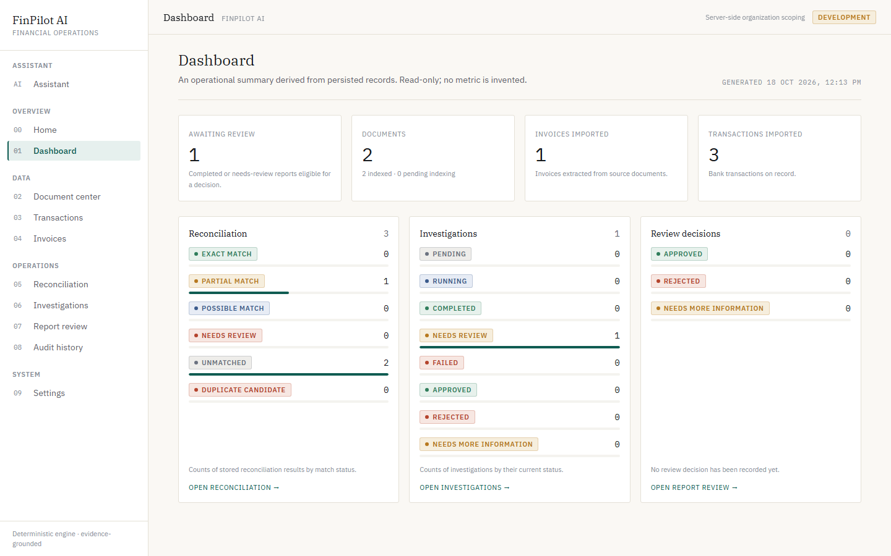
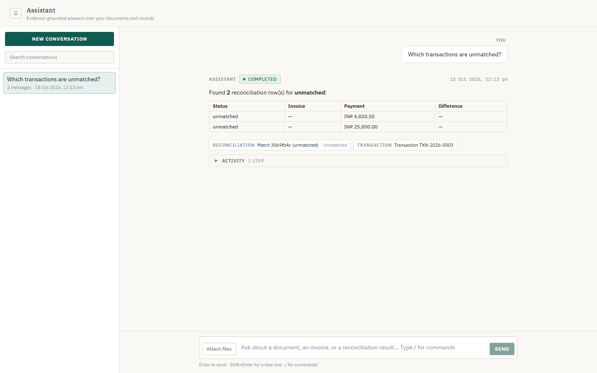
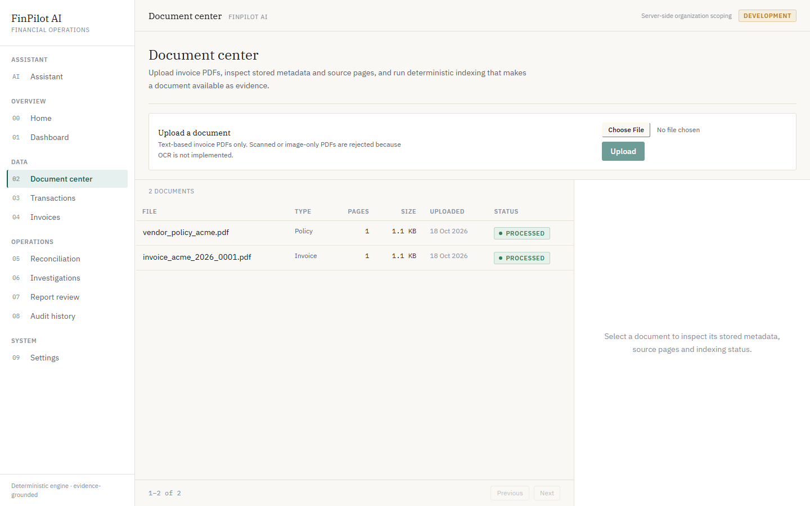
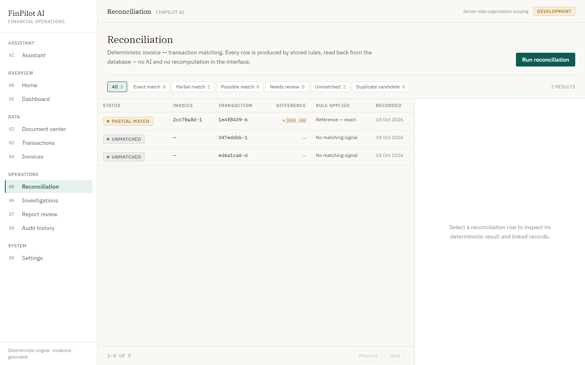
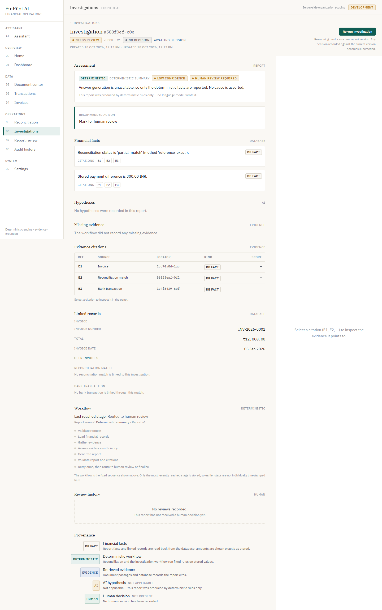
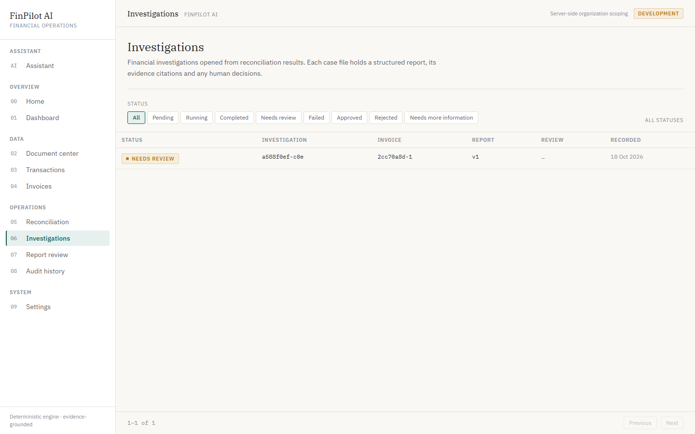
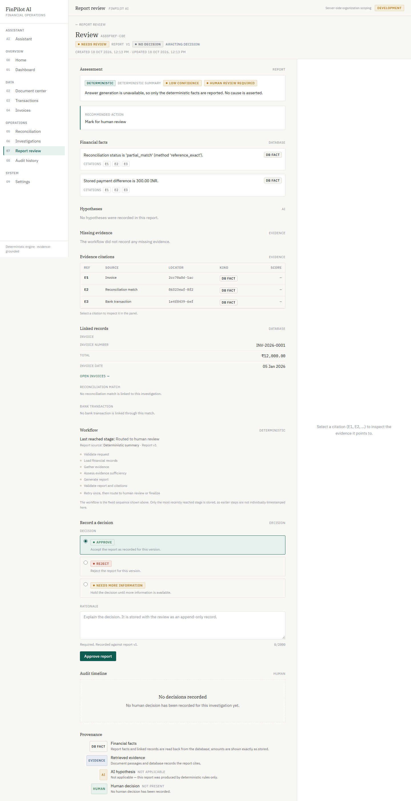
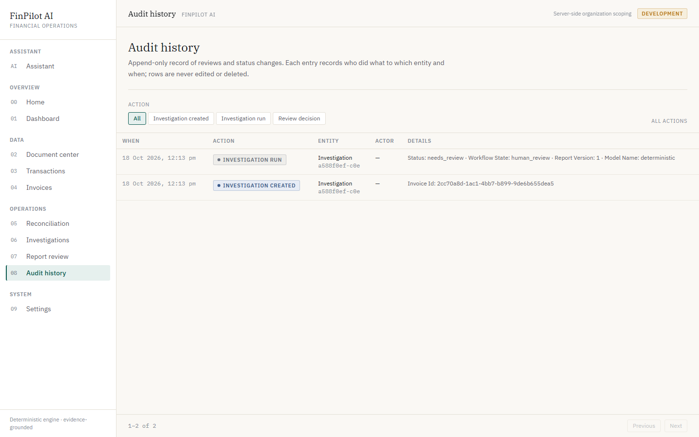

# FinPilot AI

Financial operations and reconciliation platform for small businesses and finance
teams. FinPilot AI ingests invoices and bank statements, matches them with
deterministic rules, and produces evidence-backed investigation reports that a
human reviews before anything is acted on.

> **Portfolio prototype.** This is a demonstration project, not a banking product.
> It must never initiate payments, change vendor bank details, or make
> consequential financial decisions on its own. Every irreversible action is
> gated behind human approval, and the deterministic finance core is kept
> deliberately separate from the AI.



## Table of contents

- [What it does](#what-it-does)
- [Architecture](#architecture)
- [Key design decisions](#key-design-decisions)
- [Screenshots](#screenshots)
- [Quick start](#quick-start)
  - [Option A - Docker Compose (one command)](#option-a---docker-compose-one-command)
  - [Option B - Local development](#option-b---local-development)
- [The demo scenario](#the-demo-scenario)
- [Configuration](#configuration)
- [Database migrations](#database-migrations)
- [API reference](#api-reference)
- [Testing](#testing)
- [Production notes](#production-notes)
- [Security and limitations](#security-and-limitations)
- [Project structure](#project-structure)

## What it does

1. **Ingest** invoice PDFs and bank statement CSVs.
   - PDFs are parsed with PyMuPDF; structured fields (invoice number, dates,
     amounts) are extracted with labeled, deterministic patterns.
   - CSVs are imported row-by-row with tolerant type handling.
2. **Match** invoices to transactions with deterministic, Decimal-safe rules
   (reference, amount, date window). No AI is involved in matching.
3. **Index** documents for retrieval: text is chunked and embedded locally with
   `sentence-transformers`, stored as vectors in PostgreSQL via `pgvector`.
4. **Investigate** a discrepancy through a LangGraph workflow that gathers
   cited evidence and produces a structured report. With no `GROQ_API_KEY` the
   system runs a deterministic, model-free fallback so it is always demoable.
5. **Review** the report as a human: approve, reject, or request more
   information, with a rationale. Every decision is written to an append-only
   audit trail.
6. **Audit** the lifecycle: creating, running and reviewing an investigation each
   append an event (who did what to which entity and when). The trail is
   organization-scoped, filterable and readable in the Audit history screen;
   rows are never edited or deleted.

## Architecture

```
 Browser (React + Vite + TS)
        │  /api/v1/*  (proxied by nginx in production, Vite in dev)
        ▼
 FastAPI backend
   ├── api/routes      thin HTTP layer; identity via app.api.deps
   ├── services        deterministic core: parsing, matching, RAG, reporting
   ├── agents          LangGraph investigation workflow + tools
   ├── core            config (validated settings), security (principal), logging
   └── db              SQLAlchemy session + Alembic migrations
        │
        ▼
 PostgreSQL + pgvector   (documents, invoices, transactions, matches,
                          investigations, reviews, audit events, chunks)
```

The **deterministic core never calls the LLM** and the **LLM never mutates
financial records**. The AI only reads evidence and drafts a report for a human.

## Key design decisions

- **Deterministic money math.** All amounts use `Decimal`; matching is rule-based
  and reproducible. Re-running reconciliation is idempotent.
- **Retrieval that abstains.** If no chunk clears the similarity threshold, the
  answer is "insufficient evidence" rather than a guess.
- **Citations over prose.** Investigation reports reference the exact chunk and
  source document behind each claim.
- **Human in the loop.** Reports move to `needs_review`; a reviewer decision is
  required before an investigation is considered resolved. Decisions carry the
  `report_version` they acted on, so a stale submission is rejected instead of
  silently overwriting a newer report.
- **Append-only audit.** Reviews and audit events are never updated or deleted.
- **AI is optional.** Empty `GROQ_API_KEY` ⇒ deterministic mode, no network AI.

## Screenshots

| Assistant | Dashboard |
| --- | --- |
|  |  |

| Document center | Reconciliation |
| --- | --- |
|  |  |

| Investigation report | Investigations queue |
| --- | --- |
|  |  |

| Report review | Audit history |
| --- | --- |
|  |  |

> Screenshots are generated from the live, seeded app by
> `frontend/tests/integration/screenshots.spec.ts` (see [Testing](#testing)).

## Quick start

### Option A - Docker Compose (one command)

Requires Docker with Compose v2.

```bash
cp .env.example .env      # adjust ports/credentials if needed
docker compose up --build
```

- Frontend: <http://localhost:8080>
- Backend API + docs: <http://localhost:8000/docs>
- PostgreSQL: `localhost:5433` (pgvector image)

The backend container applies Alembic migrations and then serves the API with
`ENVIRONMENT=production`. Then, from the host, seed the demo dataset through the
public API:

```bash
cd backend
python scripts/seed_live.py --reset --index --base-url http://localhost:8000
```

### Option B - Local development

Prerequisites: Python 3.11+, Node 18+, Docker (for PostgreSQL + pgvector).

```bash
# 1. Database (pgvector), published on host port 5433
docker compose up -d postgres

# 2. Backend
cd backend
python -m venv .venv
.venv\Scripts\activate            # Windows;  source .venv/bin/activate elsewhere
pip install -r requirements.txt
cp .env.example .env              # points DATABASE_URL at localhost:5433
alembic upgrade head              # apply the schema
uvicorn app.main:app --reload     # http://localhost:8000

# 3. Seed the demo dataset (from a second terminal, still in backend/)
python scripts/seed_live.py --reset --index

# 4. Frontend
cd ../frontend
npm install
npm run dev                       # http://localhost:5173
```

`scripts/generate_fixtures.py` regenerates the synthetic PDFs/CSV under
`data/synthetic/` if you want to start from scratch.

## The demo scenario

A bank statement shows a payment of **11,700.00** against an invoice of
**12,000.00**. The deterministic engine flags a **partial match** with a
**+300.00** difference. An investigation surfaces a vendor policy offering a
**300.00 early-settlement discount**, cites it, and recommends a resolution. A
human reviews the report and records an approval with a rationale.

The exact click-through steps are in
[docs/demo-scenario.md](docs/demo-scenario.md).

## Configuration

Settings are defined in `backend/app/core/config.py` (Pydantic Settings) and read
from environment variables or `backend/.env`.

| Variable | Default | Notes |
| --- | --- | --- |
| `DATABASE_URL` | local dev URL | PostgreSQL DSN. Must be explicit in production. |
| `ENVIRONMENT` | `development` | `development` \| `test` \| `production`. |
| `LOG_LEVEL` | `INFO` | Python logging level. |
| `ALLOWED_ORIGINS` | `["http://localhost:5173","http://localhost:3000"]` | **JSON list.** Wildcard rejected in production (credentials enabled). |
| `GROQ_API_KEY` | empty | Empty ⇒ deterministic, model-free mode. |
| `AUTH_PROVIDER` | `development` | `development` \| `header` \| `jwt`. `header` rejected in production. |
| `AUTH_JWT_SECRET` | empty | Required when `AUTH_PROVIDER=jwt`. |
| `STORAGE_DIR` | `storage` | Private directory for uploaded source documents. |
| `RAG_MIN_SCORE` | `0.35` | Minimum similarity for a chunk to count as evidence. |

Root `.env` (for Compose) is separate and documented in `.env.example` at the
repo root.

## Database migrations

The schema is managed with Alembic.

```bash
cd backend
alembic upgrade head        # apply migrations
alembic revision --autogenerate -m "describe change"
alembic check               # fail if models and migrations drift
```

- `migrations/env.py` resolves the URL from `DATABASE_URL` (falling back to app
  settings) and ensures the `vector` extension exists before migrating.
- Development and test create the schema from the models on boot
  (`init_db`); **production never does** - it relies on `alembic upgrade head`,
  which the backend container runs in its entrypoint.

## API reference

All routes are under `/api/v1`. Interactive docs at `/docs`.

| Method | Path | Purpose |
| --- | --- | --- |
| `GET` | `/health` | Liveness probe (no I/O). |
| `GET` | `/health/ready` | Readiness probe (DB round-trip; `503` when unavailable). |
| `POST` | `/documents/upload` | Upload a PDF (multipart, `document_type`). |
| `GET` | `/documents` | List documents. |
| `GET` | `/documents/{id}` | Document detail. |
| `GET` | `/documents/{id}/status` | Processing status. |
| `GET` | `/invoices`, `/invoices/{id}` | Imported invoices. |
| `POST` | `/transactions/import` | Import a bank statement CSV. |
| `GET` | `/transactions`, `/transactions/{id}` | Imported transactions. |
| `POST` | `/reconciliation/run` | Run deterministic matching. |
| `GET` | `/reconciliation/results` | Stored match results. |
| `GET` | `/reconciliation/results/{match_id}` | Single match. |
| `POST` | `/knowledge/index/{document_id}` | Chunk + embed a document. |
| `POST` | `/knowledge/search` | Retrieve cited chunks. |
| `POST` | `/knowledge/ask` | Answer a question from citations. |
| `POST` | `/investigations` | Create an investigation. |
| `GET` | `/investigations`, `/investigations/{id}` | List / fetch investigations. |
| `POST` | `/investigations/{id}/run` | Run the LangGraph workflow. |
| `POST` | `/investigations/{id}/review` | Record a human decision. |
| `GET` | `/investigations/{id}/reviews` | Review history. |
| `GET` | `/audit/events` | Append-only audit trail (filters: `entity_type`, `entity_id`, `action`). |
| `GET` | `/dashboard/summary` | Aggregated operations summary. |

## Testing

### Backend (unit + API)

```bash
cd backend
python -m pytest -q
```

Covers parsers, matching, reconciliation, RAG services, the investigation
workflow, reviews/audit, settings validation, the readiness probe, the identity
boundary, and the migration tree.

### Frontend (mocked E2E)

```bash
cd frontend
npm run lint            # tsc --noEmit
npm run test:e2e        # Playwright, every /api request intercepted
```

### Live integration (non-mocked E2E)

Runs the real backend (with PostgreSQL) and the Vite dev server, and seeds the
synthetic dataset through the public API. No request is mocked.

```bash
cd frontend
npm run test:e2e:integration
```

### Regenerating screenshots

```bash
cd frontend
$env:SCREENSHOTS="1"; npm run test:e2e:integration -- screenshots   # PowerShell
SCREENSHOTS=1 npm run test:e2e:integration -- screenshots           # bash
```

## Production notes

- **Readiness vs liveness.** `/health/ready` checks the database and returns
  `503` (never `500`) when a dependency is down, so orchestrators can stop
  routing without restarting a healthy process. `/health` stays I/O-free.
- **Global error handling.** Expected domain errors map to `404`/`409`/`400`;
  anything unexpected becomes a `500` with a generic body. Error messages are
  never leaked and only the exception *type* is logged (payloads can contain
  financial data).
- **Validated settings.** Production refuses a wildcard CORS origin, the
  committed development `DATABASE_URL`, the client-header identity provider, and
  a `jwt` provider without a secret.
- **Non-root containers.** The backend image runs as an unprivileged user; the
  frontend is served by nginx, which also reverse-proxies `/api` to the backend
  so the browser stays on a single origin.

## Security and limitations

- **The development identity is not authentication.** `AUTH_PROVIDER=development`
  resolves every request to a fixed single-organization principal. This is a
  documented limitation, not a security boundary, and the app logs a warning if
  it runs in production with that provider. The `header` and `jwt` resolvers show
  how a real identity source plugs into the same seam without changing any route.
- **No real money movement.** The system never initiates payments or edits vendor
  bank details.
- **Synthetic data only.** No real financial data or secrets are committed.
- Uploaded documents live in a private directory and are never served publicly.

## Project structure

```
finpilot-ai/
├── backend/
│   ├── app/
│   │   ├── api/            # routes + deps (identity boundary)
│   │   ├── agents/         # LangGraph workflow + tools
│   │   ├── core/           # config, logging, security (principal), exceptions
│   │   ├── db/             # session, init_db, base
│   │   ├── models/         # SQLAlchemy models
│   │   ├── schemas/        # Pydantic request/response models
│   │   ├── services/       # parsing, matching, RAG, reporting, dashboard
│   │   └── main.py         # FastAPI app, exception handlers, lifespan
│   ├── migrations/         # Alembic env + versions
│   ├── scripts/            # fixture generation + live seeding
│   ├── tests/              # pytest suite
│   ├── Dockerfile
│   └── requirements.txt
├── frontend/
│   ├── src/                # React + Vite + TypeScript + Tailwind
│   ├── tests/              # mocked specs
│   ├── tests/integration/  # live, non-mocked journey + screenshots
│   ├── playwright*.config.ts
│   └── Dockerfile          # multi-stage build + nginx
├── data/synthetic/         # sample invoices, policy, bank statement
├── docs/                   # demo scenario + screenshots
├── docker-compose.yml      # postgres + backend + frontend
└── .env.example
```

## License

Portfolio project for demonstration purposes.
